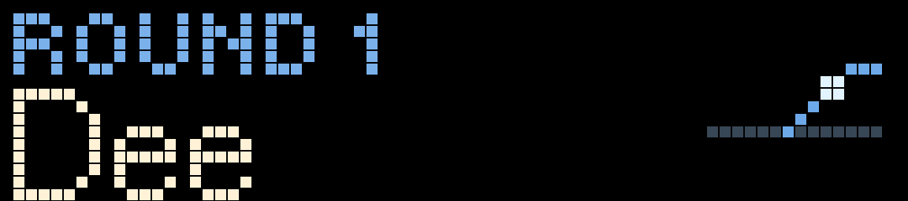
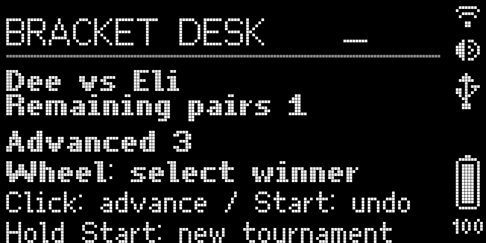

# Bracket Desk

Run a single-elimination desk tournament with byes, undo and up to eight entrants.

Bring one shared bracket to a small tournament. The next matchup appears as soon as a winner is recorded, and an incorrect result can be undone before the next game.

## Screen transitions

Advance the winner, then reverse the result to see the earlier pairing.



<details>

<summary>Watch the rear display</summary>



</details>

## Advance the first match

1. Enter two to eight entrants separated by commas in device settings. The rear lists the current matchup.
2. Turn between its two players, then click the winner. The front moves on to the next match or round.
3. The opening clip shows a choice between Dee and Eli, followed by the first name in round two.


## Correct a result

1. Press **Start** once to undo the last result and restore the previous matchup and selection.
2. Turn if the winner needs to change, then click to advance again. The clip shows the current round-two selection move back and advance.
3. After the final match the front displays **Champion**. Hold **Start** for a new tournament with the configured entrants.


## Example from the emulator

Five entrants occupy an eight-place bracket, so three get byes in the opening round. Only one real first-round match is needed before the four remaining players form the next two pairs. Entrants are seeded in their configured order.

## Run in the emulator

Open BUSY Bar Emulator. From this repository, run:

```sh
~/.busy-emulator/bin/busy-emulator dev --once
```

Press **Back** to exit.

The GIFs are excerpts from the emulator recording. Each LED occupies a 16 × 16 cell with a black border. The end frames pause for reading.

[Full recording](media/controls.mp4) · [Rear display](screenshots/back-1.png) · [Firmware test](EMULATOR-QA.md) · [MIT license](LICENSE)
